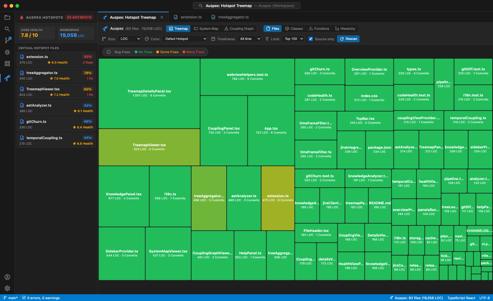
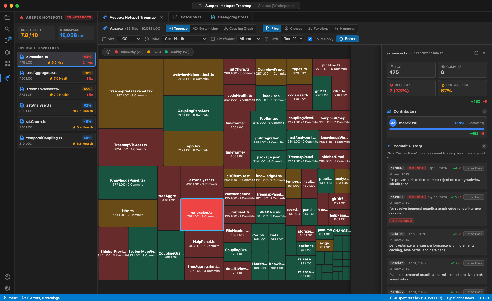
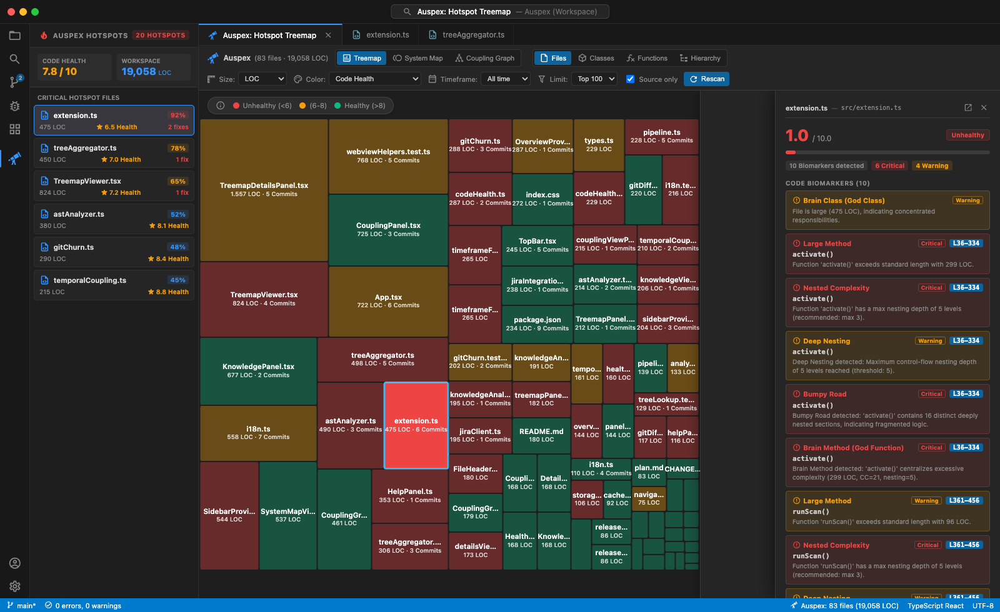
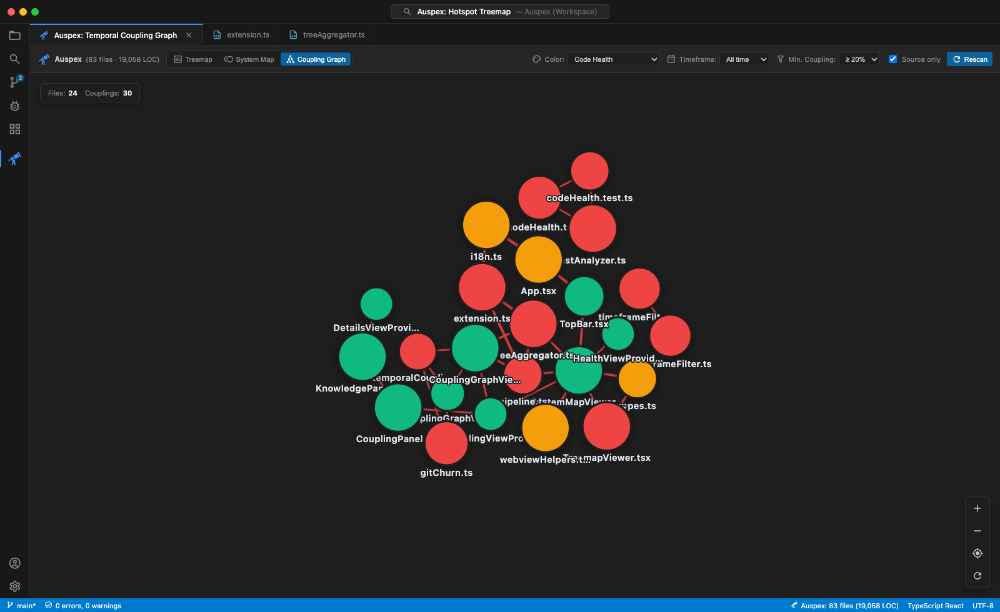
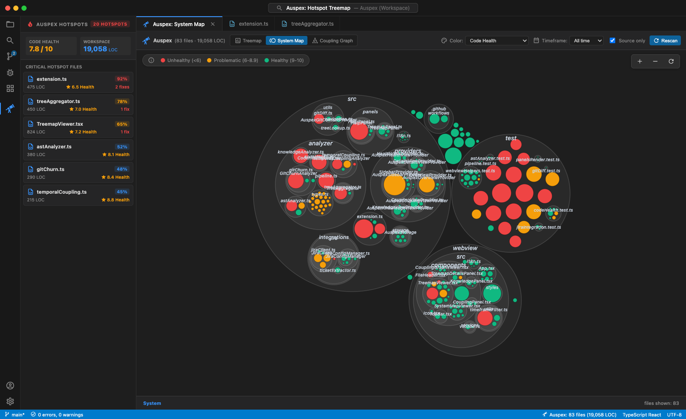
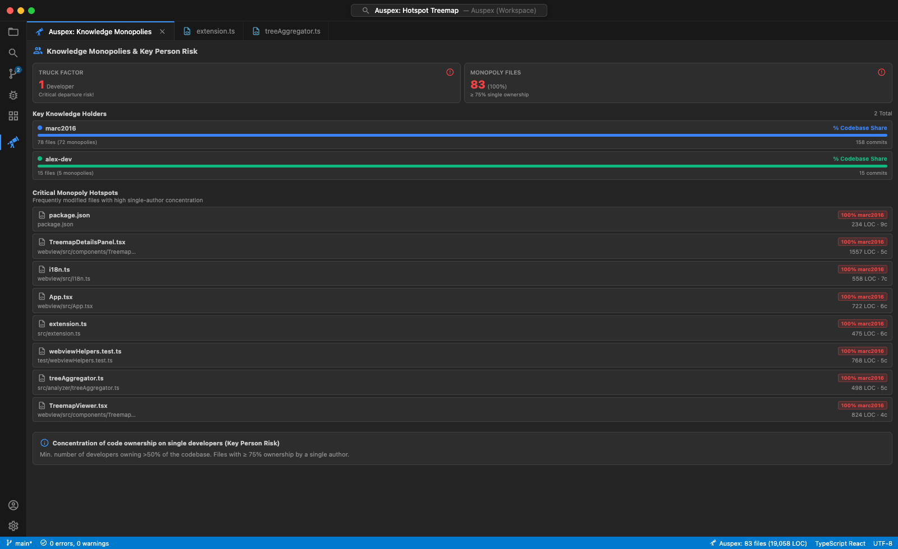

# Auspex

<p align="center">
  
</p>

<p align="center">
  <strong>Behavioral Code Analysis & Interactive Hotspot Treemap for Visual Studio Code</strong>
</p>

<p align="center">
  <a href="https://github.com/marc2016/Auspex/actions/workflows/ci.yml"></a>
  <a href="https://github.com/marc2016/Auspex/releases"></a>
  
  
</p>

<p align="center">
  
</p>

---

## 📖 Overview

Most software metrics focus solely on static complexity (like Lines of Code or cyclomatic complexity). However, complex code that rarely changes is usually safe and stable. The real risk lies at the intersection of **high complexity** and **high change frequency (Git churn)** with **frequent bugfixes**.

**Auspex** brings behavioral code analysis directly into your editor:
- It automatically analyzes your workspace's Git repository and AST code structure.
- It calculates churn rates, defect frequencies, and code growth.
- It visualizes your codebase as an interactive, hierarchical **Treemap** where you can immediately identify true technical debt and high-risk hotspots.

---

## ✨ Features

### 🗺️ Interactive Hierarchical Treemap
- **Deep Zoom & Hierarchy:** Explore your project from folder level down to individual files, classes, and methods/functions.
- **Breadcrumb Navigation:** Click any box to zoom in; use the breadcrumbs at the top to navigate back up.
- **Source Code Filter:** Toggle between all repository files and source-code-only files with a single click.
- **Top-N Limits:** Filter views to Top 50, Top 100, Top 250, or show all elements.

### 🔥 Behavioral Hotspot Detection & Inspection
- Combines **Git commit churn** with **defect frequency** (`fix:`, `bug:`, etc., or Jira bug tickets).
- Highlights risky areas using a clear thermal gradient:
  - 🟢 **Green:** Stable, low-risk code.
  - 🟡 **Yellow:** Moderate activity or complexity.
  - 🔴 **Red:** Critical hotspots (frequently modified files with repeated bugfixes).
- **Direct Editor Navigation & Git Diffs:** Click any file or function to jump directly to the editor line, view full commit history, or launch side-by-side Git diffs.

<p align="center">
  
</p>

### 🩺 Code Health & AST Biomarkers
- Comprehensive diagnostics detecting code smells and technical debt biomarkers (Brain Methods / God Functions, Bumpy Road control flow, Deep Nesting, Complex Conditionals).
- Objective **Code Health Score (1.0 – 10.0)** calculated per file and aggregated across the whole workspace with actionable refactoring advice.

<p align="center">
  
</p>

### 🔗 Temporal Coupling Analysis (Hidden Dependencies)
- Detects implicit architectural dependencies between files that frequently change together in the same commits.
- Interactive network/chord graph with configurable threshold filter (e.g. `≥ 20%`, `≥ 40%`) to uncover unexpected coupling across modules.

<p align="center">
  
</p>

### 📞 Call Hierarchy (Calls View)
- The **Calls** sidebar view shows who calls the selected function (incoming) and what it calls (outgoing) as expandable trees; recursive calls are marked and not expanded further.
- Every entry shows its Code Health, churn color and LOC; clicking an entry opens it in the editor.
- A CodeLens above each function shows the number of known callers and callees (e.g. `5 callers | 3 calls`) and opens the Calls view.
- Calls are resolved by Auspex itself for JavaScript/TypeScript: ES `import`s and `require` of relative modules, `this.x()` / `self.x()` calls inside constructors, calls across AMD `define()` modules, and receivers with a known type (`new X()` or a TypeScript annotation such as `index: FunctionIndex`). Calls matched only by name are marked as **inferred**; built-in methods like `map.get()` or `list.push()` on objects of unknown type and ambiguous method names produce no edge.
- Language servers (VS Code call hierarchy) add precise calls for the selected function on demand; with `auspex.calls.languageServer: "background"` the calls of all functions are collected after each scan (cancellable, cached per file).

### 🕸️ Call Diagram (Editor Tab)
- `Auspex: Open Call Diagram` opens the functions of the workspace as boxes nested in frames for folders, namespaces, files and classes, connected by their calls - in its own editor tab. Open several diagrams side by side, e.g. one per folder via **Open call diagram for folder** in the details view or the diagram button in the Calls view.
- Calls flow from top (callers) to bottom (callees), inside and across the frames (layered layout computed with ELK in a Web Worker). Node color follows churn or Code Health (same scales as the treemap); dashed edges = *inferred*, purple = references from XML files; calls leaving the scope are shown as a count on the calling function.
- Zoom levels: zoomed out you see frames and aggregated edges with call counts, zooming in reveals functions and their names.
- Click a function to highlight its callers and callees (and select it in the other Auspex views), double-click to open it in the editor.
- Filters: hide inferred edges, show only hotspots, restrict to a folder. The diagram updates automatically after scans and saves, keeping zoom and selection.
- **Focus on a function**: select a function and click **Focus** (or use the diagram button in the Calls view, the **In diagram** CodeLens, or *Auspex: Show Calls in Diagram* in the editor context menu). The diagram then shows only the callers above and the callees below that function, with separate depths (0-10 or all, default 2/2). Functions with more callers or callees beyond the depth show "+N", and a warning appears above 300 functions.

### 🧩 References from XML Files
- JavaScript handlers referenced in XML-based files of your own formats (any file extension) appear as **callers** in the Calls view and count towards the call CodeLens.
- Configure which files and attributes contain references with `auspex.declarativeReferences`:

```json
"auspex.declarativeReferences": [
  {
    "files": "**/*.form",
    "attributes": ["onClick", "handler"],
    "elements": ["handler"],
    "fileAttribute": "script",
    "functionAttribute": "function"
  }
]
```

- Supported values: a function name (`save`), a qualified name (`Cart.save`), a JS expression (`save(this, 1)` - every called name counts) and a file/function attribute pair on one element. Unique matches are *certain*, ambiguous names create *inferred* references to every candidate.
- After each scan, rule warnings, per-rule counts and unresolved references are listed in the **Auspex** output channel.
- Optional heuristic mode (`auspex.declarativeReferences.heuristic`, off by default) also scans unconfigured XML-like files and keeps only code-like values, always as *inferred*.

### 🌐 System Architecture Map
- High-level architectural overview grouping packages, folders, and modules as concentric circular clusters.
- Color-coded health metrics to spot architectural decay and module complexity at a single glance.

<p align="center">
  
</p>

### 👥 Contributor & Knowledge Map
- Evaluates code ownership, primary maintainers, and key person risks.
- Calculates workspace **Truck Factor** and identifies **Knowledge Monopolies** (files maintained solely by a single author) to detect fragile silos before team departures.

<p align="center">
  
</p>

### 🎨 Multi-Dimensional Visual Encodings
Switch sizing and coloring dimensions dynamically in the top bar:
- **Box Size:**
  - `LOC` (Lines of Code)
  - `Commits` (Total commit frequency)
  - `Bugfixes` (Number of bugfix commits)
  - `+Lines` (Lines added churn)
- **Box Color:**
  - `Fehler-Hotspot / Defect Hotspot` (Defect ratio × Churn score)
  - `Code Health` (1.0 – 10.0 scale)
  - `Git Churn` (Relative change frequency)
  - `Code-Wachstum / Code Growth` (Net growth ratio)
  - `Aktualität / Freshness` (Recency of the latest change)
- **Timeframe Filtering (Zeitraum):**
  - Instantly recalculate all metrics and rescale heatmap colors within a selected time window:
  - `All time` (All), `1 week`, `1 month`, `6 months`, `1 year`, or `2 years`.

### 🎫 Optional Read-Only Jira Integration
- Automatically extracts Jira ticket keys (e.g. `PROJ-123`) from Git commit messages.
- Resolves ticket types (Bug, Defect, Story, Task, etc.) via Jira REST API.
- Automatically marks Jira-verified bugs as defect fixes (`isFix = true`) to enhance hotspot accuracy.
- Renders clickable Jira badges on commit cards that open the ticket in your browser.
- **100% Optional & Secure:** Disabled by default; credentials stored securely in your OS Keychain via `vscode.SecretStorage`.

### 🌍 Bilingual Interface
- Fully localized in **Deutsch** and **English**.
- Respects your VS Code language preference automatically, with manual toggle option.

---

## 🚀 Getting Started

### Installation

#### From GitHub Releases (VSIX)
1. Download the latest `.vsix` file from [Releases](https://github.com/marc2016/Auspex/releases).
2. In VS Code, open the Extensions view (`Cmd+Shift+X` / `Ctrl+Shift+X`).
3. Click the `...` menu in the top right and select **Install from VSIX...**.
4. Choose the downloaded `.vsix` file.

### Opening Auspex

1. Open any Git repository workspace in VS Code.
2. Click the **Auspex** icon in the Activity Bar on the left.
3. Click **Auspex: Open Hotspot Treemap** or use the Command Palette (`Cmd+Shift+P` / `Ctrl+Shift+P`).

---

## ⌨️ Commands

Auspex contributes the following commands to the VS Code Command Palette:

| Command | Identifier | Description |
|---|---|---|
| `Auspex: Open Hotspot Treemap` | `auspex.openTreemap` | Opens the interactive full-screen Treemap tab. |
| `Auspex: Rescan Workspace` | `auspex.rescan` | Triggers a fresh analysis of AST and Git history. |
| `Auspex: Focus Details View` | `auspex.focusDetailsView` | Reveals the Auspex sidebar details panel. |
| `Auspex: Open Call Diagram` | `auspex.openCallDiagram` | Opens a call diagram editor tab for the workspace (or a folder). |
| `Auspex: Show Calls in Diagram` | `auspex.focusInCallDiagram` | Opens a call diagram focused on the function at the cursor (also in the editor context menu). |
| `Auspex: Show Calls` | `auspex.showCalls` | Shows a function in the Calls view (used by the call count CodeLens). |
| `Auspex: Open Guide & Documentation` | `auspex.openHelp` | Opens the built-in Auspex user guide and documentation. |
| `Auspex: Set Jira API Token` | `auspex.setJiraToken` | Safely saves your Jira API token in the OS Keychain. |
| `Auspex: Clear Jira API Token` | `auspex.clearJiraToken` | Deletes the stored Jira API token. |
| `Auspex: Test Jira Connection` | `auspex.testJiraConnection` | Tests read-only connectivity to your configured Jira host. |

---

## ⚙️ Configuration

You can customize Auspex in VS Code Settings (`Cmd+,` / `Ctrl+,` → search for `auspex`):

| Setting | Type | Default | Description |
|---|---|---|---|
| `auspex.ignorePatterns` | `string[]` | `["node_modules", "dist", "build", ".git", "out", "bin", "obj"]` | Glob patterns to exclude from analysis. |
| `auspex.declarativeReferences` | `object[]` | `[]` | Rules for JS references in XML-based files: `files` (glob or list), `attributes`, `elements`, `fileAttribute` + `functionAttribute`. |
| `auspex.declarativeReferences.heuristic` | `boolean` | `false` | Also scan unconfigured XML-like files for code-like references (always inferred). |
| `auspex.calls.languageServer` | `string` | `"onDemand"` | Use of language servers for calls: `onDemand` (selected function in the Calls view), `background` (all functions after each scan) or `off` (Auspex resolution only). |
| `auspex.jira.enabled` | `boolean` | `false` | Enable read-only Jira integration to enrich defect detection. |
| `auspex.jira.host` | `string` | `""` | URL of your Jira instance (e.g. `https://company.atlassian.net`). |
| `auspex.jira.email` | `string` | `""` | Account email for Jira Cloud authentication (leave blank for PAT). |
| `auspex.jira.bugTypes` | `string[]` | `["Bug", "Defect", "Fehler", "Incident", "Problem"]` | Issue types classified as bugs in defect ratio calculations. |
| `auspex.jira.projectKeys` | `string[]` | `[]` | Optional list of Jira project keys to restrict ticket resolution. |

---

## 🔒 Security & Privacy

- **Local Execution:** All code parsing, AST extraction, and Git analysis run 100% locally on your machine.
- **Zero Telemetry:** No code snippets, metrics, or personal data are collected or sent to external servers.
- **Keychain Security:** Jira tokens are stored exclusively via `vscode.SecretStorage` (macOS Keychain, Windows Credential Manager, or Linux Secret Service), never in plain text or `.git`.
- **Read-Only:** Jira integration only performs `GET` requests and will never create, edit, or delete any tickets.

---

## 🛠️ Development & Releases

### Prerequisites
- Node.js 20+
- npm 10+

### Setup & Build
```bash
# Install dependencies
npm install

# Run unit tests (Vitest)
npm test

# Build extension (esbuild) and webview (Vite)
npm run build

# Watch mode for extension development
npm run watch
```

### Creating a Release
Auspex includes an interactive release manager:
```bash
./release.sh
# or specify the version directly:
./release.sh 0.3.0
```
This runs tests, creates production bundles, bumps the version in `package.json`, tags the commit, and pushes to GitHub where the GitHub Action automatically packages and attaches the `.vsix` file to the GitHub Release.

---

## 📄 License

This project is licensed under the [MIT License](LICENSE).
